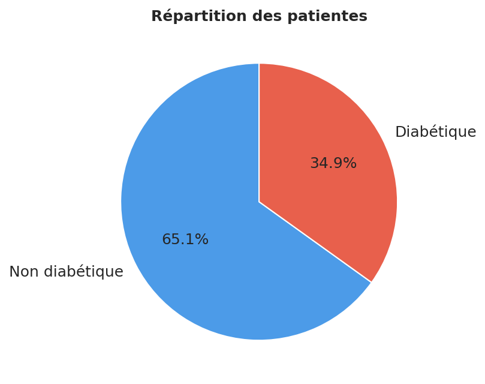
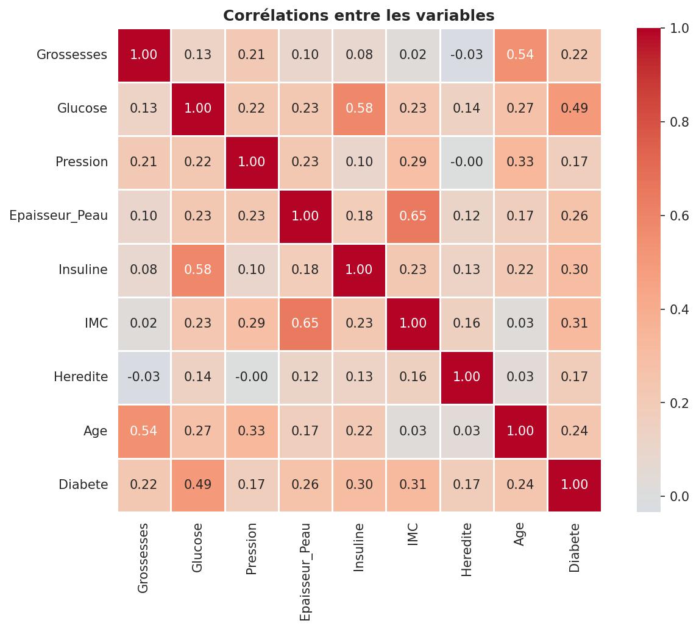
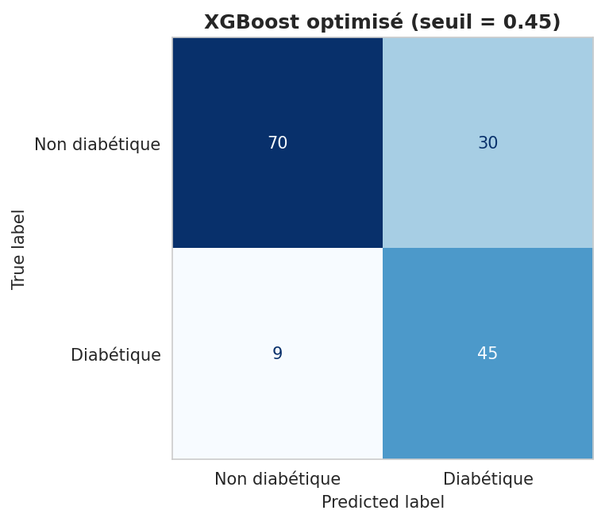
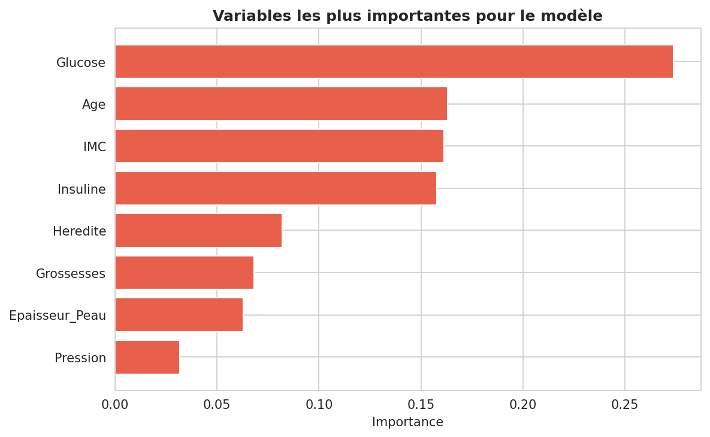

# Prédiction du diabète : Pima Indians Diabetes

Projet de data science de bout en bout : analyse exploratoire, nettoyage de valeurs manquantes déguisées, comparaison de modèles de machine learning, choix d'un seuil de décision orienté santé, et déploiement du modèle via une API **FastAPI**.

**Auteur :** KONATE ZANA Oumar, M1 Data & Intelligence Artificielle, Université Polytechnique de Bingerville (Abidjan, Côte d'Ivoire)

---

## Objectif

Prédire si une patiente est diabétique à partir de 8 mesures cliniques faciles à obtenir en centre de santé (glucose, IMC, âge, tension, etc.). Le diabète progresse en Afrique de l'Ouest et un dépistage précoce est un enjeu de santé publique : l'objectif est de **ne pas manquer les patientes malades** (priorité au *Recall*).

## Données

- **Source :** [Pima Indians Diabetes Database](https://raw.githubusercontent.com/jbrownlee/Datasets/master/pima-indians-diabetes.data.csv) (UCI / NIDDK)
- **768 patientes**, 8 variables + la cible (diabétique ou non) ; **34,9 % de diabétiques**
- Variables : nombre de grossesses, glucose, pression artérielle, épaisseur du pli cutané, insuline, IMC, score d'hérédité diabétique, âge

### Le piège du dataset : les zéros impossibles

Cinq colonnes contiennent des **0 biologiquement impossibles** (pression de 0, IMC de 0…). Ce sont des mesures non réalisées codées par 0.

| Variable | Zéros impossibles |
|---|---|
| Insuline | 374 (48,7 %) |
| Épaisseur du pli cutané | 227 (29,6 %) |
| Pression | 35 (4,6 %) |
| IMC | 11 (1,4 %) |
| Glucose | 5 (0,7 %) |

**Traitement :** remplacés par des valeurs manquantes (`NaN`), puis comblés par la **médiane** *à l'intérieur d'un `Pipeline` scikit-learn*, après la séparation entraînement/test, pour éviter toute **fuite de données** (*data leakage*).

## Analyse exploratoire

| | |
|---|---|
|  |  |

- **Glucose** est la variable la plus liée au diabète (corrélation 0,49), devant IMC (0,31) et Insuline (0,30).
- Le risque augmente nettement avec l'IMC : **6 %** (IMC normal) → **24 %** (surpoids) → **46 %** (obésité).
- Le risque augmente avec l'âge jusqu'à 50 ans environ (22 % → 48 % → 57 %). Les groupes « 60 ans et plus » (27 patientes) et « maigreur » (4 patientes) sont trop petits pour conclure.

Graphiques détaillés : [`images/`](images/)

## Modèles et résultats

Séparation 80 % / 20 % stratifiée (154 patientes de test), validation croisée à 5 plis sur l'entraînement.

| Modèle | Accuracy | Précision | **Recall** | F1 |
|---|---|---|---|---|
| Référence (répond toujours « non ») | 0,649 | 0,000 | 0,000 | 0,000 |
| Régression Logistique | 0,734 | 0,603 | 0,704 | 0,650 |
| Random Forest | 0,734 | 0,600 | 0,722 | 0,655 |
| XGBoost | 0,760 | 0,639 | 0,722 | 0,678 |

**Constats :**
- Tous les modèles battent nettement la référence.
- XGBoost et Random Forest surapprenaient (accuracy de 91,5 % / 88,1 % à l'entraînement contre 76 % / 73,4 % au test). Un réglage des hyperparamètres (`GridSearchCV`) a retenu des arbres peu profonds.
- **La régression logistique fait aussi bien que XGBoost** (AUC en validation croisée : 0,844 contre 0,840) : sur ce dataset, un modèle simple suffit.

### Choix du seuil de décision

Par défaut, un modèle classe « diabétique » dès que la probabilité dépasse 0,5. En dépistage, manquer une malade coûte plus cher qu'une fausse alerte. Le seuil a été choisi **sur l'entraînement uniquement** (prédictions en validation croisée) pour viser un Recall d'au moins 80 % : **seuil = 0,45**.

**Résultat final sur les 154 patientes de test (XGBoost, seuil 0,45) :**

| | Prédit non diabétique | Prédit diabétique |
|---|---|---|
| **Non diabétique** (100) | 70 | 30 |
| **Diabétique** (54) | **9** | 45 |

- **Recall : 0,83** (45 diabétiques détectées sur 54), contre 39 sur 54 avec le seuil par défaut
- **Précision : 0,60**, **AUC : 0,816**, accuracy : 0,75
- Quand le modèle dit « non diabétique », il a raison dans 89 % des cas




**Variables les plus importantes :** Glucose, puis Âge, IMC et Insuline.

## API FastAPI

L'API charge le modèle XGBoost sauvegardé dans son **format natif JSON** (`modele_xgboost.json`, portable d'une machine à l'autre, contrairement à un fichier pickle) ainsi que ses paramètres (`parametres_modele.json` : ordre des colonnes, médianes d'imputation, seuil de décision). Elle expose :

| Méthode | Route | Rôle |
|---|---|---|
| GET | `/health` | Vérifie que l'API fonctionne |
| POST | `/predict` | Renvoie le score de risque et la prédiction |
| GET | `/docs` | Documentation interactive (Swagger) |

`Glucose`, `IMC` et `Age` sont obligatoires. Les autres mesures sont facultatives : si elles manquent, le modèle utilise la médiane d'entraînement et l'API indique lesquelles ont été remplacées. Les valeurs impossibles (par exemple un glucose de 0) sont refusées.

### Lancer en local

```bash
git clone https://github.com/oumar-ds/diabetes-prediction.git
cd diabetes-prediction

# Python 3.12 recommandé
python -m venv venv
venv\Scripts\activate          # Windows  (Linux/Mac : source venv/bin/activate)
pip install -r requirements.txt

uvicorn app:app --reload
```

Ouvrir ensuite http://127.0.0.1:8000/docs pour tester.

### Exemple de requête

```bash
curl -X POST http://127.0.0.1:8000/predict \
  -H "Content-Type: application/json" \
  -d '{"Glucose": 148, "IMC": 33.6, "Age": 50, "Grossesses": 6, "Pression": 72, "Epaisseur_Peau": 35, "Heredite": 0.627}'
```

```json
{
  "diabete_predit": true,
  "score_risque": 0.734,
  "seuil_de_decision": 0.45,
  "valeurs_remplacees_par_la_mediane": ["Insuline"],
  "message": "Risque élevé : un test de confirmation est recommandé."
}
```

> Le `score_risque` est un score de modèle, pas une probabilité calibrée (le déséquilibre des classes a été compensé à l'entraînement).

### Tests

```bash
pytest -v
```

## Limites

1. **Petit échantillon de test** : 154 patientes dont 54 diabétiques, donc une incertitude d'environ ±10 points sur le Recall.
2. **Population non représentative** : femmes d'origine Pima (Arizona), 21 ans et plus. Le modèle n'est pas validé pour la population ivoirienne ni pour les hommes. Une utilisation réelle exigerait un réentraînement sur des données locales.
3. **Biais d'IMC** : 61 % des patientes sont en situation d'obésité, donc peu d'exemples à IMC normal.
4. **Outil de dépistage, pas de diagnostic** : seul un examen médical confirme un diabète.

## Technologies

Python, pandas, NumPy, matplotlib, seaborn, scikit-learn, XGBoost, FastAPI, Uvicorn, Pydantic, Google Colab, Git/GitHub

## Structure

```
diabetes-prediction/
├── README.md
├── app.py                    # API FastAPI
├── test_api.py               # Tests de l'API
├── requirements.txt
├── modele_xgboost.json       # Modèle XGBoost (format natif)
├── parametres_modele.json    # Colonnes, médianes d'imputation, seuil (0,45)
├── notebook/
│   └── diabetes_prediction.ipynb
└── images/                   # Graphiques de l'analyse
```

## Contact

- GitHub : [oumar-ds](https://github.com/oumar-ds)
- Portfolio : [oumar-ds.github.io](https://oumar-ds.github.io)
- LinkedIn : [Zana Oumar Konaté](https://linkedin.com/in/zana-oumar-konate-7b6480268)
